# Feature & Navigation Roadmap

This planning document extends the [Application Navigation](navigation.md) overview to map out future media processing capabilities powered by FFmpeg. It focuses on high-level screens and user-facing features across the 4-stage workflow.

## Extended Navigation & Feature Graph

```mermaid
flowchart TD
    M0["Stage 1: Media Selection"]

    subgraph S2["Stage 2: Choose Action"]
        direction TB
        subgraph S2_AUD["Audio"]
            A0["Extract Audio (MP3, AAC, WAV, FLAC)"]
            A_REP["Replace / Mix Audio Track"]
            A_MUTE["Remove Audio (Mute)"]
        end
        subgraph S2_VID["Video & Format"]
            A_FMT["Convert Format / Transcode (MP4, WebM, MKV, GIF)"]
            A_TRIM["Trim / Cut Clip"]
            A_RESIZE["Resize / Crop"]
            A_COMP["Compress / Optimize"]
        end
        subgraph S2_IMG["Frames & Images"]
            A1["Extract Frames (JPG, PNG, WebP)"]
        end
        subgraph S2_OVL["Overlays & Filters"]
            A_WM["Add Watermark (Image / Text)"]
            A_SUB["Burn / Add Subtitles"]
        end
    end

    subgraph S3["Stage 3: Configure and Run"]
        direction TB
        C0["Configure Audio Extraction\n(Format, Bitrate, Sample Rate, Output)"]
        C_REP["Configure Audio Replacement\n(Audio File, Replace/Mix, Offset, Output)"]
        C_MUTE["Configure Mute\n(Output)"]
        C_FMT["Configure Transcode\n(Container, Codec, Resolution, CRF/Bitrate, Output)"]
        C_TRIM["Configure Trim\n(Start Time, End Time / Duration, Output)"]
        C_RESIZE["Configure Resize / Crop\n(Dimensions, Aspect Ratio, Crop Box, Output)"]
        C_COMP["Configure Compression\n(Quality Preset / Target Size, Output)"]
        C1["Configure Frame Extraction\n(Format, Sampling Mode, Range, Size, Output)"]
        C_WM["Configure Watermark\n(Image/Text, Position, Opacity, Scale, Output)"]
        C_SUB["Configure Subtitles\n(Subtitle File, Burn-in / Track, Output)"]
    end

    W0["Stage 4: Wait for Completion & Show Results"]

    M0 -->|"File chosen"| S2

    A0 -->|"Selected"| C0
    A_REP -->|"Selected"| C_REP
    A_MUTE -->|"Selected"| C_MUTE
    A_FMT -->|"Selected"| C_FMT
    A_TRIM -->|"Selected"| C_TRIM
    A_RESIZE -->|"Selected"| C_RESIZE
    A_COMP -->|"Selected"| C_COMP
    A1 -->|"Selected"| C1
    A_WM -->|"Selected"| C_WM
    A_SUB -->|"Selected"| C_SUB

    C0 -->|"Start job"| W0
    C_REP -->|"Start job"| W0
    C_MUTE -->|"Start job"| W0
    C_FMT -->|"Start job"| W0
    C_TRIM -->|"Start job"| W0
    C_RESIZE -->|"Start job"| W0
    C_COMP -->|"Start job"| W0
    C1 -->|"Start job"| W0
    C_WM -->|"Start job"| W0
    C_SUB -->|"Start job"| W0
```

## Planned Capability Groups

- **Audio**:
    - **Extract Audio**: Expand beyond MP3 to AAC, WAV, FLAC, and OGG with configurable bitrate and sample rate.
    - **Replace / Mix Audio**: Import a secondary audio file to replace or mix with the existing track.
    - **Remove Audio**: Strip the audio stream (`-an`) without re-encoding video.
- **Video & Format**:
    - **Convert Format / Transcode**: Convert between containers (MP4, WebM, MKV, MOV, animated GIF) with codec and quality controls.
    - **Trim / Cut**: Extract a time range with optional stream copy for fast lossless cuts.
    - **Resize / Crop**: Scale resolution or crop to standard aspect ratios.
    - **Compress / Optimize**: Reduce file size using CRF presets or target bitrate/size.
- **Frames & Images**:
    - **Extract Frames**: Expand beyond JPG to PNG and WebP, keeping existing sampling modes (interval, time, percentage, FPS, count).
- **Overlays & Filters**:
    - **Add Watermark**: Overlay an image or text watermark with position, scale, and opacity options.
    - **Burn / Add Subtitles**: Embed `.srt` / `.ass` subtitles as a soft track or burn them into the video stream.
