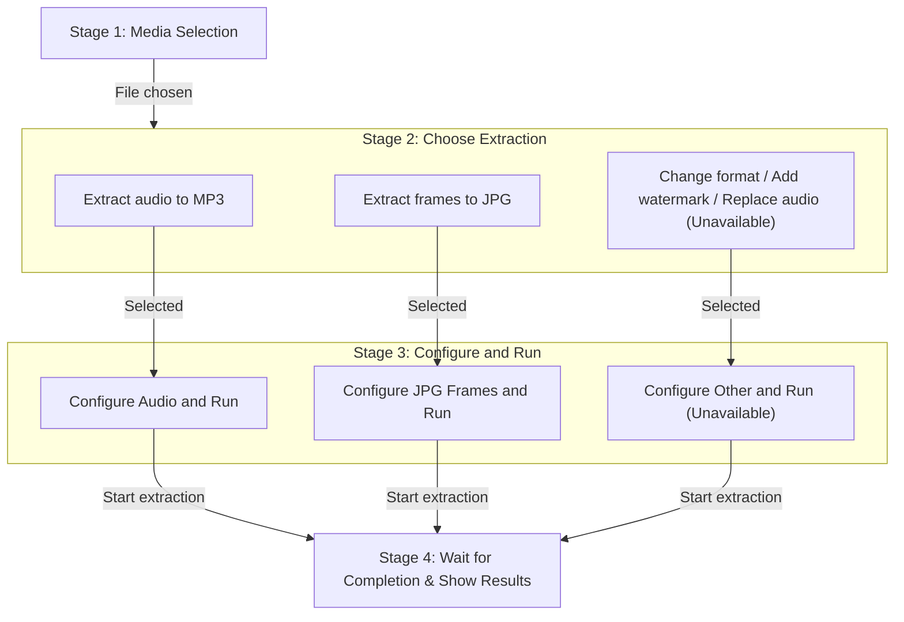
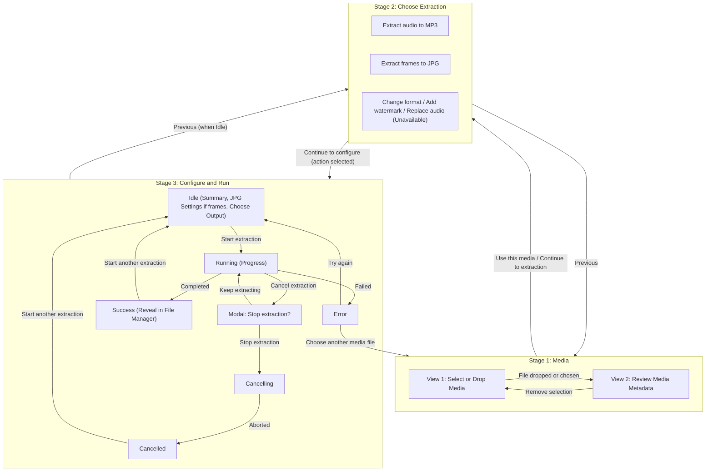

# Application Navigation

Ganzo Video Converter uses a 3-stage vertical workflow (`Swiper`) with nested horizontal carousels for media selection and extraction action choices. Forward navigation is gated on completing the required selection in the current stage, and navigation is locked while an extraction job is running or cancelling.

## Navigation Overview Graph

## In Depth Navigation Graph

## Navigation Controls

- **Top step bar (`step-nav`)**: Allows jumping to any unlocked stage (Stage 2 requires media; Stage 3 requires media and an action; disabled while a job is running or cancelling).
- **Vertical stages**: Controlled via the step bar, stage navigation buttons, mousewheel, touch swipe, or `ArrowUp` / `ArrowDown` keys.
- **Horizontal carousels**: Within Stage 1 (2 views) and Stage 2 (5 action cards), controlled via Previous/Next buttons, touch swipe, or `ArrowLeft` / `ArrowRight` keys.
